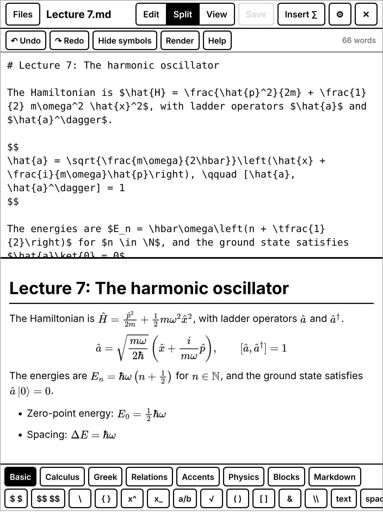
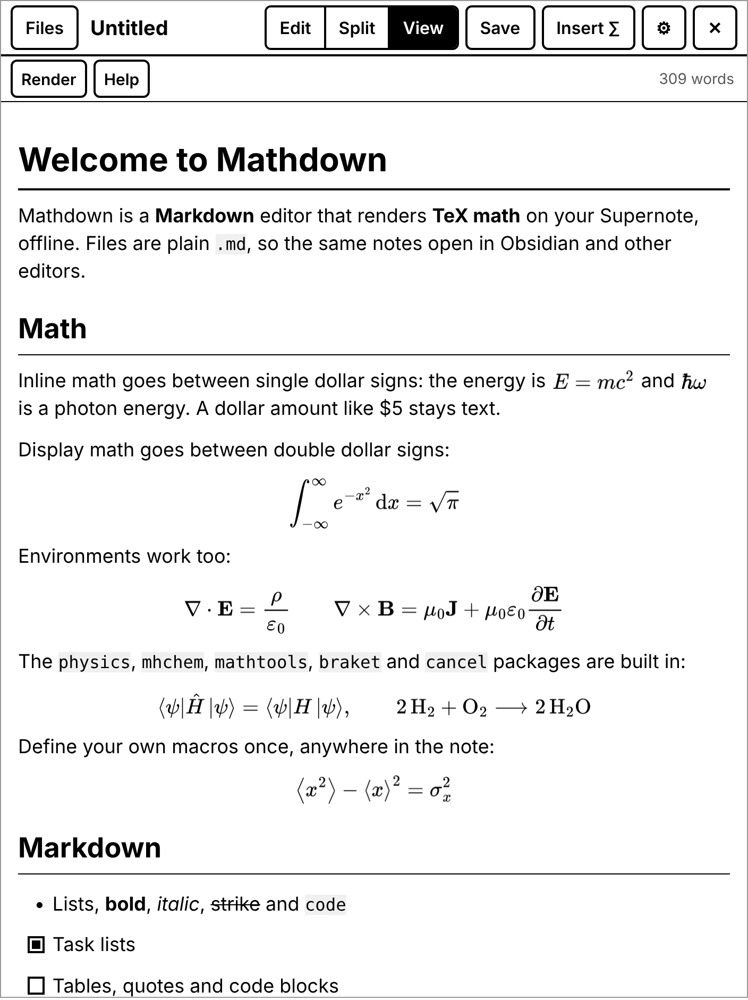
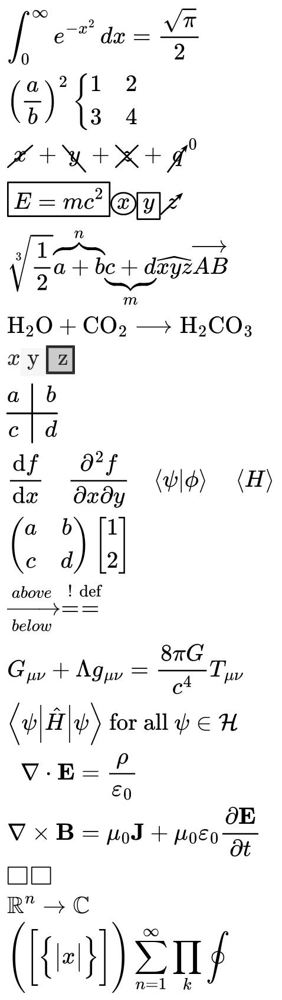

# Mathdown for Supernote

Mathdown is a Supernote plugin. It is a Markdown editor that renders TeX math on the device, with no network connection. It also puts typeset formulas into handwritten notes.

[](https://github.com/TheScholium/mathdown/actions/workflows/build.yml)
[](https://github.com/TheScholium/mathdown/releases/latest)

**Download:** [`mathdown.snplg`](https://github.com/TheScholium/mathdown/releases/latest/download/mathdown.snplg) · Tested on a Supernote Nomad (A6 X2) with Chauvet 3.30.45.

| Split view | Preview | Formula rendering |
|---|---|---|
|  |  |  |

## Features

- **Plain `.md` files.** The math syntax is the same as in Obsidian: `$...$` for inline math and `$$...$$` for display math. `\(...\)`, `\[...\]`, ```` ```math ```` fences and `\begin{align}`-type environments also work.
- **Three views.** *Edit* (source only), *Split* (source above, live preview below), and *View* (preview only). In *View*, long-press a paragraph to go to its source line.
- **Offline TeX.** MathJax 3 converts TeX to vector shapes, and a JavaScript rasterizer turns the shapes into anti-aliased PNG images. Packages: `ams`, `mathtools`, `physics`, `mhchem`, `braket`, `cancel`, `cases`, `color`, `enclose`, `bbox`, `boldsymbol`, `upgreek`, `gensymb`, `textmacros`, `newcommand`, `empheq`, `amscd`, `extpfeil`, `centernot`, `verb`. `\R \C \N \Z \Q` are built in.
- **Macros.** Use `\newcommand` anywhere in a note; it applies to the whole note. Put global macros in *Settings > Global TeX preamble*.
- **Insert into a note.** Put the cursor in a formula (or select TeX) and tap **Insert ∑**. Mathdown inserts a sharp, transparent PNG into the current layer of the open NOTE page.
- **Render TeX from the lasso.** Type TeX into a normal NOTE text box, lasso it, and tap **Render TeX** in the lasso toolbar. The UI does not open. Mixed text such as `Area $A=\pi r^2$` also works.
- **Symbol bar** for the on-screen keyboard: structures, calculus, Greek, relations, accents, physics (`\bra`, `\ket`, `\dv`, ...), environments and Markdown.
- **Safe editing.** Undo and redo, an auto-saved draft (unsaved text comes back if the plugin closes), atomic file writes, and a prompt before you lose changes.
- **E-ink design.** Black on white, no animations, large touch targets, few screen refreshes while math renders.
- **Markdown.** Headings, emphasis, strike-through, inline code, code blocks, block quotes, nested lists, task lists, tables (with alignment) and horizontal rules.

## Requirements

- Supernote Manta or Nomad with **Chauvet 3.30.45 or later** (the first stable firmware with plugins), or a plugin beta build.
- The file `mathdown.snplg` from the [latest release](https://github.com/TheScholium/mathdown/releases/latest) (or `build/outputs/` after a build).

## Install

1. Connect the Supernote to your computer (USB, Supernote Partner app, or Browse & Access).
2. Copy `mathdown.snplg` into the **MyStyle** folder on the Supernote.
3. On the Supernote, open **Settings > Apps > Plugins**.
4. Tap **Add Plugin**, select `mathdown.snplg`, and tap **Install**.
5. Open a note. Find the **Mathdown** button in the NOTE toolbar.

When Mathdown first reads or saves a file, the system asks for permission. Select **Always allow** to stop the question from coming back. If you select **Allow this time only**, the permission ends when the plugin closes.

## Use

| Task | Do this |
|---|---|
| Open the editor | Tap **Mathdown** in the NOTE or DOC toolbar. |
| Open or make a note | Tap **Files**. Tap a note to open it. Long-press a note to rename or delete it. **Browse device…** opens the system file picker. |
| Save | Tap **Save**. A new note asks for a name; the first heading is the default. |
| See the result | Tap **Split** or **View**. In *Split*, the preview updates after you stop typing (see Settings) or when you tap **Render**. |
| Type TeX quickly | Use the symbol bar. A snippet wraps the selected text if there is a selection. |
| Insert a formula into the page | Put the cursor in the formula and tap **Insert ∑**. Then move the image with the lasso. |
| Render a NOTE text box | Lasso the text box, then tap **Render TeX**. |
| Open the settings | Tap **⚙**, or tap the settings button of Mathdown in **Settings > Apps > Plugins**. |
| See the example note | Tap **Help**. |

### Where files go

| What | Where |
|---|---|
| Markdown notes | `Document/Mathdown/` (change it in Settings) |
| Formula images for notes | `EXPORT/Mathdown/formula-YYYYMMDD-HHMMSS-N.png` |
| Settings, draft, recent list | The plugin's private folder (no permission needed) |

The `Document` folder syncs with Supernote Cloud and the other sync services. Thus the notes can go to an Obsidian vault on your computer.

### Settings

- **Notes folder**, **Text size**, **Math size in preview**.
- **Size of formulas inserted into a note** (pixels per em at 300 ppi; 64 px is about the size of handwriting).
- **Live preview** on/off and its delay.
- **Close Mathdown after inserting a formula**.
- **Lasso "Render TeX": remove the text box** (off by default).
- **Global TeX preamble**.

## Build from source

The `.snplg` file is a zip with the JavaScript bundle, `PluginConfig.json`, the icons, and `app.npk` (the compiled file module). There are two ways to build it.

### A. No Android SDK (Linux or macOS)

Requires Node.js 18+, a JDK (11 or later) and `zip`.

```bash
npm install
npm run build          # = bash tools/build-plugin.sh
```

The script runs the engine tests, bundles the JavaScript with Metro, compiles the Java file module with `javac` against small stubs (`tools/native-stubs/`), converts it to DEX, and packs `build/outputs/mathdown.snplg`. If `ANDROID_HOME` is set, the script uses the SDK's `android.jar` and `d8`. If not, it downloads `android.jar` (API 30) and the `dx` dexer (dex2jar 2.4) from GitHub one time into `tools/.cache/`.

### B. Official Supernote tool chain (Android Studio)

Set up the environment as the [Supernote plugin docs](https://docs.supernote.com/en/environment) describe, then run the template's script:

```bash
npm install
./buildPlugin.sh       # Windows: .\buildPlugin.ps1
```

`MainApplication.kt` registers `MathdownFilesPackage`, so the official script builds the native part with Gradle.

### Tests

```bash
npm test               # engine tests (Node) + UI tests (Jest, mocked Supernote host)
npm run typecheck
```

## How it works

```
Markdown text
  └─ markdown-it + math rules ──► block tree (engine/markdown.js)
        └─ each formula ──► MathJax 3: TeX → SVG tree (lite DOM, no browser)
              └─ rasterizer: paths → polygons → anti-aliased coverage (engine/raster.js)
                    └─ PNG encoder (fflate) ──► data: URI in the preview
                                            └─► file in EXPORT ──► PluginNoteAPI.insertImage
```

- `engine/` is plain JavaScript with no React Native code. It runs in Hermes on the device and in Node for the tests.
- `src/` is the React Native UI. `App.tsx` is the editor; `index.js` registers the buttons.
- `android/app/src/main/java/com/mathdown/files/` is the native module. `sn-plugin-lib` has no "write text file" call, so this module adds `readText`, `writeText`, `writeBase64`, `listDir`, `rename`, `deleteFile`. The Supernote permission system still applies to it.

## Limits

- Characters that are not in the MathJax TeX fonts (for example CJK in `\text{}`) show as empty boxes in formulas. Normal Markdown text has no such limit.
- Equations are not numbered automatically (as in Obsidian). `\tag{...}` works.
- NOTE places an inserted image at a position that the plugin cannot choose. Move it with the lasso.
- Formulas inside headings use the body-size image, scaled.

## Troubleshooting

| Problem | Cause and fix |
|---|---|
| Banner "File module not loaded" | The host did not load `app.npk`. Reinstall the plugin. If the problem continues, build with path B (Gradle). |
| "Write permission was not given" | Open **Settings > Apps > Plugins > Mathdown** and allow file access, or select **Always allow** at the next question. |
| A formula shows "TeX error: ..." | The message comes from MathJax. Correct the TeX; the rest of the note still renders. |
| **Insert ∑** says to open from a NOTE | DOC files cannot hold images. Open Mathdown from a note. |

## Contributing

Bug reports and pull requests are welcome. Please give your device model and firmware version in bug reports. Run `npm test` and `npm run typecheck` before a pull request.

## License

[MIT](LICENSE). Third-party components and their licenses are listed in [THIRD_PARTY_NOTICES.md](THIRD_PARTY_NOTICES.md).

Mathdown is not made by or affiliated with Ratta / Supernote.
